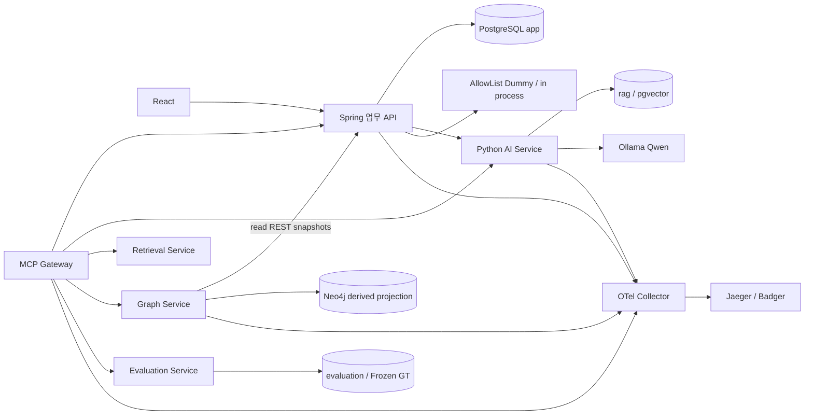

# 02. 시스템 구성과 기술 목록

조사 기준: 2026-10-28 KST. 현재 작업 트리의 소스·저장된 검증 산출물·읽기 전용 재조회가 근거다. 이번 문서 수집에서는 모델 호출, 성능 재측정, 테스트 재실행, 승인·실행·평가 생성, 기능/소스/설정/평가셋 변경을 하지 않았다.

## 실제 서비스 구성

| 구성 | 현재 소스/설정 | 책임·경계 |
|---|---|---|
| Frontend | lock 기준 React19.3.0, TypeScript5.9.3, Vite7.3.6; `frontend/package-lock.json`, `frontend/src/navigation.ts` | 현재9개 업무 화면; manifest의 ^19.1.1/^7.1.7은 버전 범위이며 lock의 실제 해석 버전과 다름 |
| Backend | Spring Boot3.5.6, JDBC/JdbcClient, Flyway, POI5.5.1; `backend/pom.xml`, `backend/Dockerfile` | app 데이터·Job·검토·실행·집계·XLSX. 현재 Java25; 과거 커밋 검증 Java21과 구분 |
| AI Service | Python3.12 Dockerfile, FastAPI/Pydantic, LangGraph>=0.6,<1; `ai-service/requirements.txt` | 검색·근거 분석·정책 TC 생성·별도 변경 영향 Graph. 아래에 실제 컨테이너 버전을 별도 기록 |
| Ollama | `ollama/ollama:0.11.10`, `qwen2.5:7b-instruct`; `compose.yaml`, `app/llm_provider.py` | 로컬 `/api/chat`; 외부 LLM API 키 불필요. 실제 호출은 해당 Provider 경로 |
| Embedding | `BAAI/bge-m3`, 1024차원, CPU, revision `5617a9f61b028005a4858fdac845db406aefb181`; `ai-service/config/embedding.json` | 생성 LLM과 별도 모델; 적재/질의 profile 일치 검증 |
| Retrieval Service | `compose.phase8.yaml`, `retrieval-service/retrieval/` | Vector/BM25/RRF/Hybrid+rerank 실험·명시적 검색 경로. 기본 분석 경로를 자동 대체하지 않음 |
| Reranker | bge-reranker-v2-m3, CPU float32, revision `953dc6f6f85a1b2dbfca4c34a2796e7dde08d41e`; Phase8 config | Hybrid 후보 재정렬; Qwen 모델/계획 생성기가 아님 |
| PostgreSQL | `pgvector/pgvector:pg16`; migration V1~V12, `docker/postgres/init/001-roles.sql` | app/rag/evaluation 스키마·역할 분리; 업무 원장 |
| MCP Server | `mcp-server/app/server.py`, `schemas.py`, `clients.py`, `compose.phase9.yaml` | Streamable HTTP 고정 Tool Gateway; DB 자격증명/임의 URL/임의 Cypher 없음 |
| Graph/Neo4j | `graph-service/app/`, `neo4j:5.26.0-community`, `compose.phase11.yaml` | 저장 업무의 파생 관계 뷰·고정 탐색; PostgreSQL 원장을 대체하지 않음 |
| OTel | Python/Java SDK·OTLP HTTP, Collector0.128.0, Jaeger2.12.0; `compose.phase10.yaml`, `observability/` | Trace·운영 메타데이터; 비동기 export 실패가 모델 결과를 바꾸지 않도록 분리 |

2026-10-28 읽기 전용 Docker 조사: master 서비스12개 running, `analysis-model-init` exited(0), Jaeger 실제 이미지2.12.0. 정확한 명칭은 `master-ai-service-1`, `master-backend-1`, `master-mcp-server-1`, `master-graph-service-1`, `master-jaeger-1`, `master-otel-collector-1` 등이다. 이 상태 확인은 기능/부하 전체 재시험이 아니다.

이번 `docker exec`의 읽기 전용 버전 확인: AI Python3.12.14 / FastAPI0.141.1 / Pydantic2.13.5 / LangGraph0.6.11 / OTel SDK1.34.1 / sentence-transformers5.1.2, Backend Temurin OpenJDK25.0.4.1+1, Frontend Node22.23.4. 사용 명령은 `python -c`의 `sys.version`·`importlib.metadata.version(...)`, `java -version`, `node --version`이며 앱/모델 호출을 수행하지 않았다. Frontend 라이브러리 숫자는 런타임 DOM 추정이 아니라 현재 lock 파일에서 읽은 값이다.

## 데이터와 흐름

**각 요청이 모든 서비스를 호출하는 구조가 아니다.** 기본 분석의 Vector 검색은 AI 프로세스에서 실행한다. 기본 TC 생성은 저장된 분석을 입력으로 받으며 새 RAG 검색을 하지 않는다. Neo4j 사용은 관계 조회/명시적 확장 경로이며 기본 분석을 GraphRAG로 바꾸지 않는다.

| 저장 구역 | 쓰기/읽기 주체 | 데이터 |
|---|---|---|
| app | migration_owner DDL, app_user 업무 DML | Requirement, 분석, 생성 배치·원본/검토 revision, execution, Job, Phase15 baseline/proposal/analysis/review |
| rag | migration 적재, AI/retrieval의 rag_reader SELECT | manifest 기반 합성 문서·청크·임베딩 |
| evaluation | 전용 evaluation_reader 및 제한된 record_run 함수 | 동결 GT/binding/catalog·평가 run/snapshot. 일반 생성 자격증명에 미포함 |
| Neo4j | Graph 서비스의 파생 projection | Requirement/BusinessRule/Api/TestCase/Evidence/Execution 및 고정 관계 |

DB 세부: [역할 bootstrap](../../docker/postgres/init/001-roles.sql), [migrations](../../backend/src/main/resources/db/migration), [평가 경계](../../evaluation-service/app/main.py). 모델 입력에는 GT를 제공하지 않는다. 저장 보고서의 GT snapshot과 일반 로그/Trace의 허용 메타데이터를 구분한다.

## 서비스 간 주소와 프로토콜

| 경로 | 실제 설정 |
|---|---|
| UI/Backend/AI | localhost:5173 / :8080 / :8000, 내부 `backend:8080`, `ai-service:8000` |
| Retrieval/MCP/Graph | loopback :8010 / :8020/mcp / :8030 |
| AI→모델 | `http://ollama:11434/api/chat`, 모델 초기 적재는 별도 init 컨테이너 |
| 앱→Collector | `http://otel-collector:4318/v1/traces` (OTLP HTTP) |
| Collector→Jaeger | `jaeger:4317` (OTLP gRPC, 내부 plaintext) |
| Host 관측 | Collector14317/14318, health13133; Jaeger UI16686, loopback 바인딩 |

실제 receiver/port는 [복구 설정 대조](../observability-recovery/config-before-after.md)와 [runtime-after](../observability-recovery/runtime-after.json)를 따른다. 기존 컨테이너마다 생성 시점 override가 다를 수 있으므로 base Compose의 공개 포트만 보고 현재 DB 노출 여부를 단정하지 않는다. 외부 운영용 인증·TLS 체계를 구현했다는 뜻은 아니다.

## Graph 역할과 동기화

현재 label6종과 관계7종은 `graph-service/app/model.py`에 닫혀 있다: `SUPPORTED_BY`, `AFFECTS`, `GENERATES`, `IMPLEMENTED_BY`, `VERIFIED_BY`, `BASED_ON`, `EXECUTED_AS`. 명세·Evidence·endpoint 일치로 검증된 관계만 만든다. canonical API는 승인·자산상세·반납·검사4종이며 API 노드 존재가 실행 지원을 뜻하지 않는다.

`source.collect`는 현재 생성 배치의 TC와 해당 TC의 실행을 읽는다. `refresh.Refresher`가 독립 순회 후10초 간격으로 변경 snapshot을 반영하며 source 조회/처리 시간이 추가된다. `store.py`는 대상 소유 관계를 교체하고 공유 정본·다른 요구사항·기존 노드를 보존한다. 즉시 트랜잭션 동기화나 전체 과거 이력 그래프를 보장하지 않는다. [동기화 복구](../graph-sync-repair/README.md) 참조.
