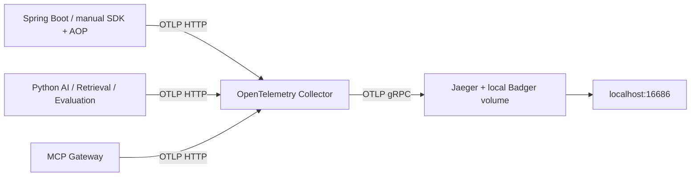
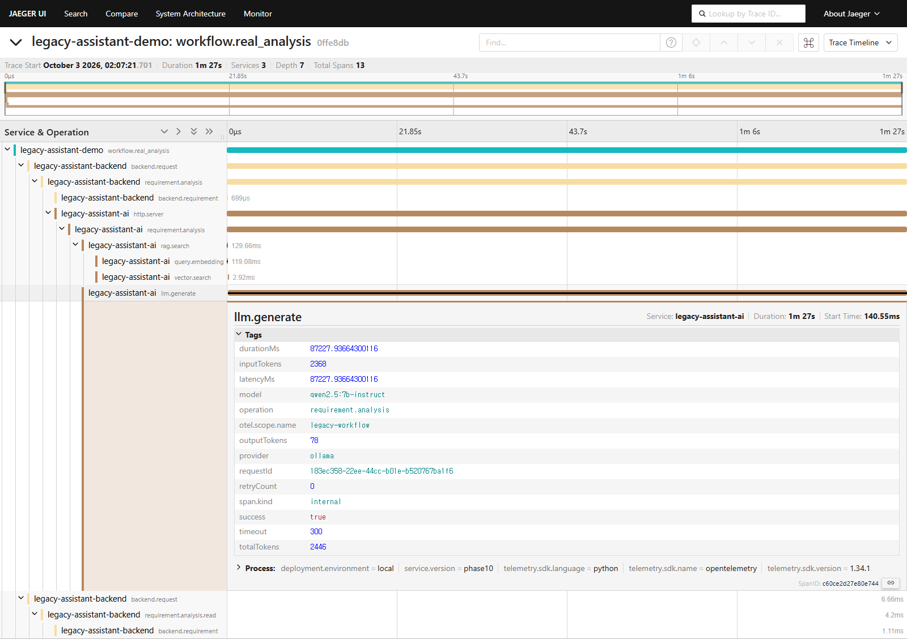

# Phase 10 — AI Observability / Distributed Tracing

Phase 9 기준점 552개 파일을 고정하고 기존 흐름에 OpenTelemetry 계측을 추가했다. 기존 파일 중 8개는 계측 연결·의존성·헤더·로그만 수정했고 나머지 544개는 그대로다. 실제 Qwen2.5 분석은 대표 Requirement **1건·모델 호출 1회**만 수행했다. 업무 UI, Prompt, Retrieval/평가/승인/Dummy 판정 로직, DB migration과 권한은 변경하지 않았다.

## 1. 목적

업무 기능 추가 없이 서비스 호출 관계, 검색 전략, 모델 사용, 병목과 실패 위치를 동일 Trace에서 확인한다. 기존 REST와 MCP 기능은 동시에 유지된다. 모델의 추론 내용 대신 operational metadata만 저장한다.

## 2. OpenTelemetry 아키텍처

Collector contrib 0.128.0, Jaeger 2.6.0, Java SDK 1.49.0, Python SDK/OTLP exporter 1.34.1. `compose.phase10.yaml`와 `observability/`를 추가했다. 기존 서비스·Postgres·Ollama·frontend는 유지한다. Jaeger UI는 [localhost:16686](http://localhost:16686), Collector health는 localhost:13133. OTLP gRPC/HTTP 두 receiver는 각각 host14317/14318에 loopback으로 공개한다. Jaeger는 로컬 `jaeger-data` volume으로 재시작 후 Trace를 보존한다.

## 3. Trace propagation

W3C traceparent/tracestate를 HTTP 호출에 전달한다. 실제 연결은 MCP → Backend 또는 AI/Retrieval, Backend → AI, Evaluation → Backend/AI다. 존재하지 않는 Backend → MCP 업무 경로를 새로 만들지 않았다.

서버 진입은 SERVER span, 내부 작업은 자식 span이다. Backend는 RestClient interceptor, Python은 ASGI context와 HTTPX/urllib header 주입을 사용한다. requestId를 별도로 유지하며 traceId/spanId/requestId가 같은 구조화 로그에서 확인된다. 실제 분석의 Backend·AI 로그에서 동일 requestId도 검증했다. 응답에는 X-Trace-Id 헤더만 추가했고 업무 JSON은 바꾸지 않았다.

[로그 상관관계 검증](phase10-evidence/log-correlation-check.json), [구조화 로그](phase10-evidence/correlated-logs.json). 브라우저 사용자 동작마다 서로 다른 HTTP Trace가 생기며, 테스트 Client가 수행한 하나의 Workflow는 root span으로 묶는다. 브라우저 전체 세션을 하나의 Trace로 과장하지 않았다.

## 4. 계측 대상

| 영역 | span / 주요 attribute |
|---|---|
| Backend | backend.request, backend.requirement, requirement.analysis/read, testcase.generate/read, review, dummy.execution/read |
| RAG | rag.search: retrieval.strategy, topK, candidateCount, resultCount, latencyMs |
| Embedding | query.embedding: embedding.model, inputLength, vectorDimension, latencyMs |
| 검색 세부 단계 | vector.search, lexical.search, rerank(model/candidateCount) |
| LLM | llm.generate: model/provider/operation/latencyMs/success/retryCount/timeout, 제공된 token usage |
| TC 생성 | testcase.generate: generatedTestCaseCount/executableCandidateCount/evidenceCount |
| 평가 계산 | evaluation: recallAt5/scenarioCoverage/validityRate/evaluatedItemCount |
| MCP | mcp.tool: toolName/requestId/resultStatus/downstreamService/durationMs |
| Dummy | dummy.execution: 허용된 apiId/result/mismatchCount/durationMs |

저장 결과 조회에는 LLM span을 만들지 않는다. Phase 3 분석의 기존 VECTOR 검색을 유지했으며 waterfall을 꾸미려고 reranker를 넣지 않았다. Review 화면 조회에는 승인 변경 span을 만들지 않는다. review span은 기존 실제 edit/decide 호출에만 적용한다. TestCase 생성 계측은 기존 합성 fixture와 mock 모델로 검증했다. Metrics/Prometheus는 Distributed Trace 구현에 집중하기 위해 생략했으며 ID를 metric label로 사용하지 않았다.

## 5. 대표 Workflow Trace

| 시나리오 | Trace | 실제 확인 |
|---|---|---|
| A_HYBRID | [2e4df2040e8c58c37f0818906b27a65f](http://localhost:16686/trace/2e4df2040e8c58c37f0818906b27a65f) | Requirement 조회 → Hybrid, embedding/vector/lexical |
| B_REAL_ANALYSIS | [0ffe8dbcbfed3a6a3c9f3f7cd7b252c8](http://localhost:16686/trace/0ffe8dbcbfed3a6a3c9f3f7cd7b252c8) | 실제 Qwen 1회 → 저장 및 조회 일치 |
| C_MCP | [4554d39f1a4fea1b232d93e5c2643172](http://localhost:16686/trace/4554d39f1a4fea1b232d93e5c2643172) | MCP get_test_cases → Backend |
| D_PASS | [8e30586b197705f10b22615288a952b2](http://localhost:16686/trace/8e30586b197705f10b22615288a952b2) | 승인 Dummy PASS |
| E_FAIL | [cd088862b51b396283975c40c31d5526](http://localhost:16686/trace/cd088862b51b396283975c40c31d5526) | 합성 결함 FAIL, mismatch 4개 |
| F_NOT_APPROVED | [2cd97e571780e423a43bc92aff0318b3](http://localhost:16686/trace/2cd97e571780e423a43bc92aff0318b3) | 미승인 실행 차단 |
| F_API_NOT_ALLOWED | [f1308ee314ea50da86e23e0b67aa04a5](http://localhost:16686/trace/f1308ee314ea50da86e23e0b67aa04a5) | AllowList 위반 차단 |

대표·오류·측정·브라우저 요청 **30개 Trace, 176개 span**을 Jaeger에서 직접 내려받아 구조·부모 관계·서비스·오류 코드를 검사했다. 합성 오류는 synthetic=true root와 별도 기록으로 구분한다. [Trace 목록](phase10-evidence/trace-ids.json), [원본 Trace](phase10-evidence/traces/).

Chrome 154.0.8037.58에서 Requirement 조회 → 저장 Analysis → TC/Review 확인 → 승인 실행 → PASS/FAIL → 새로고침 후 이력 확인을 수행했다. 이때 응답의 X-Trace-Id로 Jaeger에 연결했다. 브라우저 오류와 추가 모델 호출은 0이다.

[전체 waterfall](phase10-evidence/trace-overview.png) · [RAG](phase10-evidence/rag-span.png) · [LLM](phase10-evidence/llm-span.png) · [MCP](phase10-evidence/mcp-span.png) · [PASS](phase10-evidence/execution-pass-span.png) · [FAIL](phase10-evidence/execution-fail-span.png) · [reranker](phase10-evidence/reranker-span.png)

## 6. RAG latency

다음은 실제 Jaeger span duration이다. VECTOR 중첩 span을 이중 집계하지 않았고, 명시적 warmup과 mock은 제외했다. 표의 p95는 nearest-rank이며 소표본 결과다.

| Workflow / span | count | mean ms | p50 ms | p95 ms | max ms |
|---|---:|---:|---:|---:|---:|
| VECTOR | 3 | 73.181 | 72.399 | 76.643 | 76.643 |
| HYBRID | 3 | 69.749 | 69.892 | 70.618 | 70.618 |
| HYBRID_RERANK | 3 | 4349.515 | 4349.668 | 4383.945 | 4383.945 |
| reranker | 3 | 4277.712 | 4279.108 | 4311.912 | 4311.912 |
| LLM analysis | 1 | 87223.903 | 87223.903 | 87223.903 | 87223.903 |
| MCP tool | 1 | 36.298 | 36.298 | 36.298 | 36.298 |
| dummy execution | 2 | 4.605 | 4.605 | 6.047 | 6.047 |

대표 질의는 '자산 대여 승인'이다. Phase 8 전체 32개 질의 평균 분포와 직접 비교하면 질의 구성 차이가 있어, 원래 phase2-1 질의를 그대로 사용한 추가 비교도 3회씩 수행했다.

| 동일 Phase 8 질의 phase2-1 | 과거 해당 질의 ms | 현재 3회 p50 ms |
|---|---:|---:|
| VECTOR | 100.437 | 86.301 |
| HYBRID | 98.375 | 86.128 |
| HYBRID_RERANK | 5665.778 | 4845.921 |

같은 corpus/config/model에서 순위·벡터·RRF·reranker 점수가 동일했다. 더 짧은 대표 질의와 warm 상태가 초기 차이의 일부를 설명한다. 같은 질의에서도 과거보다 12~15% 빠른 측정값이 나왔으므로 이를 계측의 성능 개선으로 해석하지 않는다. 과거와 현재의 프로세스·CPU 스케줄링·캐시 조건을 완전히 동일하게 통제하지 못한 한계가 있다. [동일 질의 비교](phase10-evidence/matched-baseline-comparison.json).

BM25 보조 점수만 최대 약 8.9e-16 차이가 있었다. 변경하지 않은 Phase 9 이미지에서 PYTHONHASHSEED 1/2로 재현했으며 원인은 기존 set 순회에 따른 부동소수점 덧셈 순서다. 순위는 같고 보조 점수 검증에는 명시적으로 1e-12 허용 오차를 적용했다. 기존 검색 코드는 수정하지 않았다. [원인 검증](phase10-evidence/baseline-lexical-roundoff.json).

## 7. LLM latency

대표 Requirement `438c6b1b-e41e-4083-93da-72c0be1597bf`를 Phase 3 정상 사례와 같은 입력으로 새로 저장해 분석했다. 기존 Requirement/분석은 덮어쓰지 않았다. 전체 POST 분석은 **87.384초**, llm.generate는 **87.224초**, 같은 Trace의 RAG는 약 **0.130초**였다. 과거 Phase 3 같은 정상 사례 기록은 108.91초이며 해당 파일은 그대로 보존했다.

실제 모델 qwen2.5:7b-instruct / provider ollama / retryCount=0 / timeout=300초. 제공된 inputTokens=2368, outputTokens=78, totalTokens=2446. 실제 usage 값만 기록했으며 reasoning/thinking/content는 수집하지 않았다. 표본 1이므로 p50/p95가 같은 값이며 분포 추정 근거로 쓰지 않는다. [실제 호출 기록](phase10-evidence/real-analysis.json).

## 8. MCP latency

대표 mcp.tool span은 36.298ms다. 별도 12회 warm read-only 측정에서는 전체 MCP get_test_cases 요청 p50=23.870ms, p95=26.924ms였다. Trace span과 Client HTTP 측정은 서로 다른 호출 집합임을 구분한다.

같은 논리 작업(TC 조회 + 5개 eligibility 조회)의 REST/MCP 비교도 기존 Client로 재실행했다. REST p50=19.161ms, MCP p50=17.719ms, 차이=-1.442ms. 음수 값은 연결 재사용·실행 편차가 adapter 비용보다 큰 측정이라는 뜻이며 MCP가 더 빠르다는 결론이 아니다. [원시 비교](phase10-evidence/mcp-adapter-comparison.json).

## 9. Execution latency

대표 PASS/FAIL의 dummy.execution span은 평균 4.605ms, p50=4.605ms, p95/max=6.047ms(2건)였다. 12회 warm HTTP 실행의 p50=7.809ms, p95=10.660ms다. 기존 코드가 Expected/Actual을 비교하며 PASS/FAIL 판정에 LLM은 쓰지 않는다. 의도적 합성 결함은 FAIL 및 mismatchCount=4로 표시되고 해당 span은 ERROR/DUMMY_TEST_FAIL이다. 실행 결과와 기존 이력 조회도 검증했다.

## 10. 병목 Top 3

부모 Workflow 시간을 중복 합산하지 않고 실제 하위 작업 span의 중앙값으로 순위를 정했다.

1. **LLM generation: 87.224초** (실제 1회).
2. **reranker: 4.279초** (warm 3회 중앙값).
3. **query embedding: 61.084ms** (대표 Trace의 12개 embedding span 중앙값).

Embedding에는 AI 컨테이너의 첫 검색 1회가 포함되어 max/p95=4.972초, mean=477.522ms였다. 기존 provider가 첫 호출에 모델을 적재하므로 초기화 비용이 포함된 것으로 해석하며 warm 추론과 구분한다. 병목 개선이나 모델/검색 튜닝은 수행하지 않았다.

## 11. Observability overhead 및 장애 격리

같은 호스트·질의·endpoint에서 도입 전/후 각각 warmup 2회 후 12회를 측정했다. 아래는 Client 관측 시간이며, 순차 before/after 비교라 순수 계측 비용을 인과적으로 분리한 수치는 아니다.

| 동일 요청 | 도입 전 p50 / p95 ms | 도입 후 p50 / p95 ms | p50 차이 ms | p95 차이 ms |
|---|---:|---:|---:|---:|
| VECTOR | 85.189 / 91.433 | 72.862 / 82.197 | -12.327 | -9.236 |
| HYBRID | 91.562 / 100.672 | 79.200 / 82.658 | -12.362 | -18.014 |
| MCP_READ | 23.774 / 27.198 | 23.872 / 26.924 | +0.098 | -0.275 |
| DUMMY | 8.218 / 10.040 | 7.809 / 10.663 | -0.410 | +0.623 |

음수 차이는 warm 상태·실행 편차의 영향을 포함한다. 특정 목표 숫자에 맞추거나 과거 데이터를 덮어쓰지 않았다. [원시 표본과 비교](phase10-evidence/overhead-comparison.json).

Collector와 Jaeger를 **둘 다 중단**하고 VECTOR/HYBRID/MCP 조회/Dummy를 48회 측정(+warmup 8회)했으며 전부 정상 처리됐다. 저장 분석 조회도 성공했다. finally에서 스택을 복구했고 기존 실제 LLM Trace가 Badger 저장소에서 유지됨을 확인했다. 추가 모델 호출은 0이다. [장애/복구 검증](phase10-evidence/outage-results.json).

SDK 비동기 batch·bounded queue·1초 exporter timeout과 Collector의 memory limit/retry 제한을 사용한다. 관측 장애 중 일부 Trace 유실 가능성은 허용하며 업무 응답을 exporter에 종속시키지 않는다.

## 12. 실패 Trace 사례

LLM_TIMEOUT, LLM_INVALID_OUTPUT, RAG_NO_RESULT, VALIDATION_FAILED, MCP_TOOL_REJECTED, TEST_NOT_APPROVED, TEST_NOT_EXECUTABLE, FIXTURE_NOT_READY, API_NOT_ALLOWED, DUMMY_TEST_FAIL **10종 모두 확인**했다.

LLM timeout/invalid output과 NOT_EXECUTABLE/FIXTURE_NOT_READY는 mock·합성 경로로 구분했다. 승인·AllowList 거부, 빈 검색, 입력 검증, MCP 변조, 의도적 Dummy FAIL은 실제 서비스 요청이다. error.type/code/message는 안전한 코드만 기록하며 원본 예외 메시지와 stack을 export하지 않는다. [오류 Trace](phase10-evidence/error-traces.json).

## 13. 보안 / 민감정보

Trace·새 운영 로그에는 Ground Truth, 전체 prompt, 모델 추론, API key/DB password/Authorization, 사용자/문서 원문, contentSnippet, SQL·DB parameter를 저장하지 않는다. UUID는 유효한 형태만 허용하고 attribute allowlist를 적용했다. 실제 Trace 전체 JSON에서 금지 key와 주입 sentinel을 검색했으며 30개 Trace/176개 span 모두 통과했다. exception event가 없는 것도 확인했다. [민감정보 검사](phase10-evidence/sensitive-data-check.json).

Evaluation span에는 수치 결과만 선택한다. Gateway/Collector/Jaeger에는 평가 DB credential이나 Ground Truth mount를 추가하지 않았다. DB migration 추가 없음, app/rag/evaluation 권한 경계 회귀 통과. 일반 사용자 React 화면은 변경하지 않았다. 검증용 Requirement/Analysis 1건, Evaluation 1건과 실행 이력은 새로 추가했으며 기존 Requirement·Review·evidence·Ground Truth 행을 덮어쓰지 않았다.

## 14. Phase 0~9 회귀

**기존 243개 + Observability 9개 = 252개 테스트 통과**, failure/error/skip 0. 별도 MCP E2E **70개 항목 통과**, 합성 MCP 오류 Trace 2종 검증. 실제 모델을 사용하는 테스트는 위 대표 1건뿐이다.

기존 Backend84 / AI61 / Evaluation40 / Retrieval27 / retrieval metric13 / MCP18을 그대로 실행했다. 초기에 재생성한 AI 컨테이너에서 테스트용 corpus/source fixture가 없어 2건이 실패했고, 기존 합성 fixture를 복원한 뒤 전체 통과했다. 업무 코드 수정으로 우회하지 않았다.

Vector baseline 8개 질의의 순위·score 유지, 저장 Review/evidence 일치, Ground Truth replay·DB role checks 통과. Phase 8의 기존 384개 표본과 모든 집계 지표를 재계산해 일치함을 확인했다. Phase 3/8/9 Evidence는 변경하지 않았다. [회귀 결과](phase10-evidence/regression-results.json), [Phase 8 검증](phase10-evidence/phase8-experiment-verification.json), [서비스 상태](phase10-evidence/service-health.json).

## 15. 변경 파일

기존 파일 변경은 다음 8개다. 프롬프트·SQL·업무 판정 구현 파일은 보존했다.

- `ai-service/app/llm_provider.py`
- `ai-service/app/main.py`
- `backend/pom.xml`
- `backend/src/main/java/com/example/legacyassistant/analysis/AnalysisClient.java`
- `backend/src/main/java/com/example/legacyassistant/testcase/TestCaseClient.java`
- `evaluation-service/app/main.py`
- `mcp-server/app/server.py`
- `retrieval-service/retrieval/api.py`

추가 구현: `backend/.../observability/`의 Tracing/TraceFilter/TraceHttpInterceptor/WorkflowAspect, `observability/python/workflow_otel/`, Collector/Jaeger 설정, 서비스별 계측 Dockerfile, `compose.phase10.yaml`, 테스트 overlay와 검증 스크립트. 전체 목록은 [changed-files.json](phase10-evidence/changed-files.json)에 있다.

기준점 `docs/phase9-baseline/sha256.json` 및 source.zip, 결과 `docs/phase10-evidence/`, 본 보고서를 추가했다. 실제 프로젝트 `D:/MASTER과정`에 반영했다. [실행 및 재현 방법](../observability/README.md).

## 16. 알려진 한계

실제 LLM 표본은 1건, 검색 steady-state는 전략별 3건이므로 SLA/부하 성능으로 일반화하지 않는다. 순차 before/after로 순수 overhead를 분리할 수 없고, 모델 초기화는 warm 추론과 구분해야 한다. 과거 BM25 보조 점수의 ~10^-15 재시작 오차는 확인만 했으며 튜닝하지 않았다.

Trace 저장은 단일 로컬 Badger이며 인증·HA·장기 retention 정책은 범위 밖이다. 관측 장애 시 Trace 일부 유실은 가능하다. Metrics stack, 브라우저 전체 세션 tracing, 모든 Review 수정의 실제 운영 재실행은 하지 않았다. 기존 리뷰를 보존하기 위해 Chrome에서는 저장 Review를 확인했다. 일반 테스트는 mock을 사용한다.

최종 실제 프로젝트 Compose 적용 후 서비스 health, MCP 재연결, 영속 LLM Trace 접근을 다시 확인했다. [실제 경로 검증](phase10-evidence/deployment-check.json).

완료 조건 관련 차단 사항은 없다. Phase 11 Knowledge Graph/GraphRAG, A2A, 모델·Prompt·Retrieval 튜닝은 진행하지 않았다.

공식 근거: [OpenTelemetry Python](https://opentelemetry.io/docs/languages/python/instrumentation/), [Java SDK](https://opentelemetry.io/docs/languages/java/sdk/), [Collector 구성](https://opentelemetry.io/docs/collector/configuration/), [Jaeger v2.6 Badger 구성](https://github.com/jaegertracing/jaeger/blob/v2.6.0/cmd/jaeger/config-badger.yaml).
