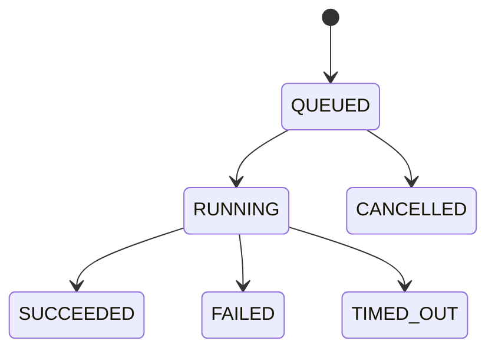

# Phase 14 — AI Analysis Async Job Queue & Progress Monitoring

완료 브랜치: `phase14/async-analysis-jobs`. 실행 환경: 기존 Compose, Chrome, PostgreSQL, Qwen2.5 7B Instruct. Phase 15는 구현하지 않았다. 구현 당시에는 미커밋 상태였으며, 최종 커밋 검증은 아래 13절에 기록했다.

## 1. 사전 점검과 호환성 선택

기존 React → Spring `POST /api/requirements/{id}/analysis` → Python RAG·Qwen → 검증·저장은 모델 완료까지 HTTP 요청을 유지했다. Python의 공유 semaphore는 분석·테스트 생성·Graph 분석의 실제 실행을 1건으로 제한한다. 기존 Ollama timeout 300초, Structured Output 보정 재시도 최대 1회, Spring read timeout 630초를 확인했다.

동기 API를 202 응답으로 바꾸면 기존 MCP와 호출자의 응답 계약이 깨진다. 기존 API를 유지하고 일반 React 실행만 신규 Job API로 전환했다. 시작 시 기존 UI 브랜치와 변경사항을 보고한 뒤 전용 브랜치를 만들었다. 기존의 비정상 이름 untracked 파일도 보존했다.

## 2. 신규 구조와 상태

React 접수 → `app.analysis_job` 커밋 → 202·Location 반환 → Spring Worker 원자적 claim → 기존 Python 분석 호출 → 기존 validator → 분석 결과·SUCCEEDED 같은 트랜잭션으로 저장. 새 브로커를 추가하지 않았다.

V11 migration은 Job 테이블, 활성 requirement unique partial index, 대기열 index, 상태 전이·종료 불변 trigger를 추가한다. 입력 SHA-256 fingerprint, Worker ID, 실행 token, lease, traceparent를 저장한다. 원문을 Job 로그·Trace에 넣지 않는다. 결과 JSON은 기존 테이블과 계약을 사용한다.

## 3. API

| API | 동작 |
|---|---|
| POST `/api/requirements/{id}/analysis-jobs` | 202 + Location. 활성 Job이면 같은 ID 반환 |
| GET `/api/analysis-jobs/{jobId}` | 상태·단계·경과/대기/실행시간·오류·결과 위치 |
| GET `/api/requirements/{id}/analysis-jobs` | 활성 우선, 최근 20개, 새로고침 복원 |
| GET `/api/analysis-jobs?requirementId=...` | 선택 범위 또는 전체 집계·최근 작업 |
| POST `/api/analysis-jobs/{jobId}/cancel` | QUEUED만 취소. RUNNING은 409 |
| POST·GET `/api/requirements/{id}/analysis` | 기존 동기 실행·저장 조회 계약 유지 |

조회는 분석을 실행하지 않는다. API에는 실행 token·Worker·lease·traceparent를 노출하지 않는다. 없는 Job은 404, 가득 찬 대기열은 429 `JOB_QUEUE_FULL`이다.

## 4. Queue·동시성·복구

접수 capacity 검사는 transaction advisory lock으로 직렬화한다. 활성 Job unique index와 같은 트랜잭션의 확인으로 중복을 막는다. Worker는 `FOR UPDATE SKIP LOCKED` 기반 claim으로 token과 소유권을 한 번에 얻는다.

동기/비동기 경로는 동일한 PostgreSQL session advisory lock을 사용한다. 별도 DB 연결에서 실행 전체 동안 유지하며 Python semaphore도 유지한다. Worker가 두 개여도 실제 동시 분석은 1개다. heartbeat는 1초마다 lease를 갱신한다. 저장은 유효 token·RUNNING·미만료 lease 확인 및 row lock 이후에만 가능하다.

재시작 후 QUEUED는 DB에서 계속 처리한다. 이전 RUNNING은 lease 만료에 더해 전역 lock 획득과 Python slot idle 확인 후 `FAILED/JOB_WORKER_ERROR`로 정리한다. 이전 작업을 자동 재실행하지 않는다. 이전 Worker의 늦은 결과는 token/상태 fence가 차단한다. 결과 저장과 SUCCEEDED는 한 트랜잭션으로 묶었다.

## 5. 설정과 Timeout·재시도

| 설정 | 기본값 |
|---|---:|
| `ANALYSIS_JOBS_ENABLED` | true |
| `ANALYSIS_JOBS_QUEUE_LIMIT` | 5 대기 |
| `ANALYSIS_JOBS_MAX_CONCURRENT` | 1 |
| `ANALYSIS_JOBS_LEASE_SECONDS` | 30초 |
| `ANALYSIS_JOBS_POLL_MS` | 1000ms |
| `ANALYSIS_JOBS_TIMEOUT_SECONDS` | 660초 |
| 기존 `ANALYSIS_TIMEOUT_SECONDS` | 630초 |
| 기존 `ANALYSIS_LLM_TIMEOUT_SECONDS` | 300초 |

Spring property 이름은 `analysis.jobs.*`다. max-concurrent는 claim 상한이며 현재 단일 로컬 모델의 session lock·semaphore 때문에 값을 높여도 실제 실행 상한은 1이다. 병렬 모델 처리는 이번 범위에 포함하지 않는다.

Job timeout은 기존 최대 2×300초 모델 호출과 저장 여유를 고려했다. 실행 중인 HTTP를 interrupt해 종료했다고 가정하지 않는다. 호출 반환 후 deadline을 검사하고, Timeout이면 Python slot 해제를 확인한 뒤 TIMED_OUT 처리·lock 해제·다음 작업을 진행한다. 짧은 Job timeout은 실제 호출을 강제로 중단하는 hard deadline이 아니다.

Job의 모델 오류 자동 재시도는 0회다. 기존 분석 내부 schema 보정 정책은 유지한다. idle probe 직후 다른 기능이 Python slot을 선점한 429 경합만 최대 3회 재접근하며 deadline을 함께 검사한다. 실제 모델이 시작된 오류 호출을 무조건 반복하지 않는다. 사용자의 종료 후 재시도는 새 Job을 만든다.

오류는 `LLM_TIMEOUT`, `LLM_UNAVAILABLE`, `LLM_INVALID_OUTPUT`, `RAG_RETRIEVAL_ERROR`, `VALIDATION_FAILED`, `ANALYSIS_BUSY`, `JOB_QUEUE_FULL`, `JOB_WORKER_ERROR` 및 기존 입력 제한 오류로 구분한다. 실패 시 기존 정상 결과는 덮어쓰지 않는다.

## 6. React·대시보드

Job 상태·실제 확인 가능한 단계·경과시간·대기 순서·오류 원인/행동·저장 결과·명시적 재시도·대기 취소를 표시한다. 세부 RAG/추론 이벤트는 기존 Python이 제공하지 않아 `LLM_ANALYSIS`를 AI 서비스 전체 분석 처리로 설명한다. 가짜 퍼센트나 임의 단계 상승은 없다.

기본 2.5초, 비활성 탭 15초 polling이며 탭 복귀 시 즉시 조회한다. 조회 연결 오류를 실제 실패와 구분하고 자동 신규 분석을 하지 않는다. 선택 requirement는 localStorage, 작업은 DB 목록 조회로 복원한다.

대시보드는 진행/대기 및 최근 24시간 성공/실패·시간 초과를 별도로 집계한다. 기존 분석 결과 수, TC FAIL과 혼합하지 않는다. 작업에서 해당 변경 요청으로 이동한다. 네이비·화이트·에메랄드 기존 UI와 대시보드·Excel·검토·실행·평가·Graph를 유지한다.

## 7. 실제 모델 대표 1건

합성 예제 ‘부서장 대여 승인 및 자기 승인 금지’를 Chrome에서 저장하고 분석했다.

| 항목 | 실제 측정 |
|---|---:|
| 생성 HTTP | **21.766ms**, 202 |
| 클릭~응답 관측 | 65.83ms |
| Queue 대기 | 0.653초 |
| Worker 실행 | 132.584초 |
| LLM span | 132.166초 |
| RAG span | 0.373초 |
| 전체 | **133.237초** |
| 결과 | SUCCEEDED, 기존 저장 API 조회 성공 |

Job `957e5e4b-8809-408e-a1a2-6fd8d1577d61`, requirement `8d9be176-b84a-494f-ab8f-a41159e1dbd7`. Trace에 실제 `llm.generate` 1개, retryCount 0을 확인했다. 모델 시간은 기존 제시 범위 70~110초보다 약 22초 길었다. 관측된 추가 시간은 모델 구간에 있으며 Queue나 저장 지연은 아니다. cold load와 CPU 실행을 분리한 계측은 없어 내부 원인까지 단정하지 않는다. 비교 목적으로 실제 모델을 반복 호출하지 않았다.

Chrome에서 시작 → 즉시 ID → 진행 → 다른 화면 → 재진입 → 새로고침 → 같은 ID → 성공 → 저장 결과 → 테스트 생성 화면 및 버튼 활성화를 확인했다. 생성 버튼은 추가 실제 모델 호출을 피하기 위해 누르지 않았고, 기존 생성·검토·실행은 자동 회귀와 기존 저장 사례로 검증했다.

## 8. OpenTelemetry

create/enqueue/claim/execute/complete/fail/poll span을 추가했다. execute는 새 Trace이며 접수 Trace에 SpanLink를 걸어 Jaeger의 `FOLLOWS_FROM`으로 확인했다. Python RAG·LLM은 실행 Trace 하위로 이어진다. jobId/requirementId/status/stage/attempt/error 및 Queue/실행/전체 시간으로 구분한다. 요구사항 원문·Prompt·추론·GT를 span에 기록하지 않는다.

실제 Worker Trace: `bc318aa8d4dc2eaac53174356e31954d`. [Jaeger 화면](http://localhost:16686/trace/bc318aa8d4dc2eaac53174356e31954d). JSON과 `jaeger-job-trace.png`를 함께 저장했다. 실패 span은 Fake 장애 시나리오로 확인했다.

## 9. 검증 결과

| 검증 | 결과 |
|---|---|
| Spring 전체 | 111 tests, 실패/오류/skip 0. Job API·상태·fence·Worker·기존 분석·TC·검토·실행·대시보드·Excel 포함 |
| Python AI | 64 tests 통과, 신규 capacity/timeout 3건 포함 |
| Retrieval | 27 tests 및 기존 동결 검색 8건 Top-5/점수 일치 |
| Evaluation | metrics 22 + API 12 + 격리 DB 9 tests 통과 |
| MCP | unit 18 + 실제 REST/MCP E2E 70 assertions 통과 |
| Graph / Graph 분석 | projection 18 + 분석 4 tests 통과 |
| OTel | 9 tests 및 실제 Jaeger Trace 확인 |
| Frontend | `tsc -b && vite build` 통과 |
| Fake 다중 Worker | 동시 peak 1, 중복 8클릭 같은 ID, 1실행+5대기, 초과429 |
| Fake 장애 | 모델 불가/잘못된 출력/RAG 오류/timeout/강제 종료/늦은 응답/정상 결과 보존/다음 Job 통과 |
| Chrome | 복원·연결 오류·명시적 재시도·대시보드 상세 이동·Excel 실제 다운로드 통과 |
| 화면 크기 | 1920/1440/1024/390 캡처, 모바일 Job 가로 overflow 없음 |

과거 Phase 9 E2E의 ‘도구 정확히 5개’ assertion은 현재 Phase 11의 8개 도구와 불일치했다. 제품 MCP 소스는 변경하지 않고 증거 폴더의 검증 복사본에서 두 개의 count assertion만 8로 조정했다. 저장 분석 경로를 사용해 추가 실제 모델 호출은 0회다.

평가 DB 테스트는 초기화된 격리 DB에 기존 hash가 일치하는 동결 GT를 준비해 수행했다. 운영 GT·평가셋은 변경하지 않았다. 보호 대상 59개 파일 hash 변경 0건. 운영 요구사항 32→33, 분석 21→22는 대표 검증 추가분이며 TC 25건은 유지했다. 기존 MCP 승인 실행 회귀로 execution 로그만 148→174 추가됐다. 기존 데이터 삭제·검토 수정은 하지 않았다.

Fake 접수 18샘플 평균 16.60ms, 최대 36.04ms. 실제 접수도 1초 목표 이내다. 상세 20개 필수 시나리오는 `scenario-coverage.json`과 JUnit/Fake/Chrome 증거에 대응한다.

## 10. 변경 파일

- `backend/src/main/resources/db/migration/V11__analysis_jobs.sql`
- `backend/src/main/java/com/example/legacyassistant/jobs/`의 `AnalysisGate`, `AnalysisCapacity`, `JobStore`, `JobController`, `JobWorker`
- `backend/src/main/java/com/example/legacyassistant/analysis/AnalysisService.java`, `AnalysisClient.java`
- `backend/src/test/java/com/example/legacyassistant/jobs/JobStoreTest.java`, `JobWorkerTest.java`
- `ai-service/app/analysis_api.py`, `llm_provider.py`; `ai-service/tests/test_job_capacity.py`
- `frontend/src/AnalysisJob.tsx`, `analysis-jobs.css`, `RequirementAnalysis.tsx`, `Requirements.tsx`, `Dashboard.tsx`
- 이 보고서 및 `docs/phase14-evidence/`

Python 변경은 read-only capacity 조회와 timeout/오류 분류다. 검색·모델 설정·분석/TC 프롬프트·Structured Output schema·평가 기준·MCP 계약·Graph 구조는 변경하지 않았다.

## 11. 알려진 한계

- Python이 slot 점유 여부만 제공하므로 세부 검색/추론 진행률과 강제 실행 취소를 제공하지 않는다. RUNNING 취소 버튼은 없다.
- Timeout 이후 Python에 연결할 수 없으면 실제 종료를 확인할 때까지 안전하게 lock/heartbeat를 유지한다. 서비스가 영구 복구되지 않으면 관리자가 해당 서비스 상태를 복구해야 한다. 연결 단절만으로 실행 종료를 가정해 두 번째 분석을 시작하지 않는다.
- slot idle은 Python 요청 종료를 뜻한다. Ollama 서버 내부 프로세스별 취소 확인 API는 추가하지 않았다. 기존 provider timeout·연결 종료 정책을 유지한다.
- 기존 분석 저장소는 requirement별 최신 결과 한 건이다. analysisResultId는 기존 requirement_analysis 키이며 별도 immutable 버전이 아니다. Job의 결과 digest가 현재 결과와 일치할 때만 resultAvailable=true이고 갱신된 과거 Job은 최신 결과 안내를 표시한다.
- 운영 인증·분산 broker·모델 병렬화·Phase 15 영향 비교는 범위 밖이다. 모바일은 Chrome viewport 검증이며 실기기 Safari 검증은 수행하지 않았다.

## 12. 실행·증거

기존 Compose backend/frontend/AI 이미지를 재빌드·배포했다. 접속: http://localhost:5173 → 변경 요청 분석. 재시작은 기존 `compose.yaml` + phase8/9/10/11 overlay 구성을 유지한다. 별도의 DB 관리자 계정으로 Worker를 실행하지 않는다.

필수 JSON·스크린샷, 실제/합성 구분 결과, 원본 JUnit, 각 회귀 로그, 실제 Excel, Trace API JSON, 보호 hash 결과는 [phase14-evidence](phase14-evidence/)에 있다. `job-*.json/png`는 Fake 장애/상태 검증, `real-*`는 실제 Qwen 대표 1건이며 둘을 혼합하지 않았다. 검증 코드 복사본은 `validation/`에 보관했다.

## 13. 커밋 전 재검증 (2026-10-26)

현재 브랜치 `phase14/async-analysis-jobs`, 기준 커밋 `26483bb`에서 Phase 14 변경을 재검토했다. Job 생성·조회·취소 API, DB 상태 전이, Worker lease/token fencing, 기존 동기 분석과 실행 잠금 공유, React polling·복원·오류 표시를 확인했다.

- 격리된 임시 PostgreSQL과 현재 backend 소스로 `mvn -B -ntp test`: 111 tests, failures/errors/skipped 모두 0. JobStore 8개와 JobWorker 9개 포함.
- 현재 AI 소스를 읽기 전용 마운트하여 unittest discover: 64 tests, 모두 통과. 신규 capacity/timeout 3개 포함.
- frontend `npm run build` (`tsc -b && vite build`): 통과. 첫 시도는 sandbox의 esbuild spawn EPERM으로 차단됐고, 동일 명령을 권한을 높여 재실행하여 통과했다.
- 실제 모델·브라우저·타 서비스 검증은 기존 증거를 검토했으며 이번 재검증에서 재실행하지 않았다.
- `.env`, 인증키, DB, 모델 캐시, node_modules, .venv, dist 빌드 변경, 임시 로그, before-* 백업, 로컬 경로가 포함된 실행 설정은 커밋에서 제외했다. .env.example은 기존 추적 템플릿이다.
- 증거 폴더는 검토용 JSON 결과와 PNG 화면만 선별했다. 위 구현 당시 기록 중 원본 로그·JUnit·실행 스크립트·Excel·중복 보고서에 대한 링크는 로컬 보관 자료이며 커밋에는 포함하지 않는다.
- 비정상 이름의 기존 미추적 파일은 보존하고 제외했다. Phase 15 개발 및 Git 이력 재작성은 수행하지 않았다.

미해결 테스트 실패는 없다. RUNNING 강제 취소 미지원, soft timeout, 최신 결과 1건 저장 등 11절의 설계상 한계는 유지된다.