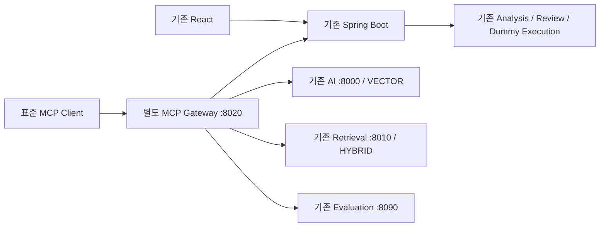

# Phase 9 완료 보고서

Phase 8 기준 소스·Evidence 197개 파일을 보존하고 별도 MCP Gateway를 추가했다. 기존 REST/UI와 MCP가 동시에 동작한다. 신규 DB migration, 검색/분석/평가/승인 로직 변경, 신규 Qwen 호출은 없다.

## 1. 목적

외부 표준 MCP Client에서 기존 검색, 분석, TestCase, 평가 및 승인 Dummy 실행을 재사용한다. 실제 외부 Agent 제품 설치 없이 별도 Client 컨테이너의 공식 Python SDK 호출로 검증했다.

## 2. 구조

Streamable HTTP `http://127.0.0.1:8020/mcp/`, health `/health`. SDK 1.26.0, 협상 프로토콜 2025-11-25. DB 접근은 기존 서비스만 수행한다. 별도 `compose.phase9.yaml` overlay를 추가했으며 기존 Compose 파일은 변경하지 않았다. 실제 전체 8개 서비스 재시작과 정상 복구를 [검증](phase9-evidence/restart-results.json)했다.

## 3. Tools

| 이름 | 기존 호출 | 동작 |
|---|---|---|
| search_knowledge | AI `/internal/v1/search`, Retrieval `/internal/v1/retrieval` | 기존 VECTOR/HYBRID 결과 매핑 |
| analyze_requirement | Requirement GET, Analysis GET/POST | 저장 분석 재사용, 없을 때만 기존 분석 수행 |
| get_test_cases | TestCase GET + 각 TC execution-eligibility GET | evidence/review 유지, 현재 실행 가능 상태 반환 |
| get_evaluation_result | 기존 evaluations GET | 최신 저장 평가에서 허용된 지표만 선택 |
| execute_approved_test | 기존 `/api/test-cases/{id}/executions` POST | ID만 전달, body 없음, 서버에서 조건 재검증 |

[실제 tools/list JSON](phase9-evidence/mcp-tools-list.json). 분석과 실행 Tool은 readOnlyHint=false이며 실행 Tool은 idempotentHint=false다. 기존 REST API를 제거하거나 교체하지 않았다.

## 4. Resource

`requirement://{requirementId}`: 읽기 전용. Requirement 원문·status, analysisExists, testCaseCount, reviewSummary 반환. templates/list 및 read를 실제 검증했다. 외부 URL·변조 경로·Ground Truth URI는 거부한다. [실제 응답](phase9-evidence/requirement-resource.json).

## 5. Input / Output Schema

모든 Tool 입력은 `additionalProperties:false`. UUID는 정규형 UUID 패턴 및 format 검증을 통과해야 한다.

| Tool | 입력 | 출력 |
|---|---|---|
| search_knowledge | query 1~2000자(공백만 불가), topK 정수 1~5 기본5, strategy VECTOR/HYBRID 기본VECTOR | strategy, hits[].documentId/chunkId/documentType/section/contentSnippet/rank/score |
| analyze_requirement | requirementId | analysis: 기존 AnalysisResult 8개 필드 그대로, analysisSource: SAVED/GENERATED |
| get_test_cases | requirementId | 기존 batch, testCases[].type/scenario/preconditions/expectedResult/evidence/approvalStatus, 현재 executable/fixtureReady/executionEligible, executionAssessment |
| get_evaluation_result | requirementId | retrievalMetrics/testScenarioCoverage/testCaseValidity/missingScenarios/evaluationMetadata |
| execute_approved_test | testCaseId만 허용 | 기존 executionId/testCaseId/requirementId/revision/request/expected/actual/result/mismatches/duration 등 원본 실행 응답 |

AnalysisResult는 기존 Python 모듈을 Docker build에서 복사하여 Schema로 사용한다. 스키마 해시 동일성을 확인했다. 새 프롬프트/분석 모델을 만들지 않았다. analysis는 변경 없는 본문이고 analysisSource는 Gateway envelope에만 추가했다.

TestCase의 생성 당시 executable은 generationExecutable로 남기고 현재 flags는 Phase 7 API에서 가져온다. review/evidence 원본은 수정하지 않는다. HYBRID score는 fusionScore, VECTOR score는 기존 cosine score다. 서로 다른 척도로 직접 비교하지 않는다. Reranker는 제외했다.

## 6. 권한 / 보안

입력에 method, endpoint, URL, SQL, command, expected override, approvalStatus, executable, fixtureReady, prompt를 추가하면 실행 이전에 INVALID_ARGUMENTS를 반환한다. execute Tool은 저장된 TC ID만 전달하며, 기존 서버의 APPROVED AND executable AND fixtureReady AND AllowList 조건을 매번 재검증한다. 클라이언트 상태나 Gateway 캐시로 승인을 대체하지 않는다.

고정 내부 HTTP 대상 4개만 사용하고 redirect는 따라가지 않는다. 검색 질의에 URL/명령문이 포함되어도 검색 문자열로만 전달되며 명령이나 주소로 실행하지 않는다. 임의 shell/SQL/HTTP/Ground Truth Tool은 없다. Tool 오류는 MCP CallToolResult `isError:true` + errorCode/requestId, 잘못된 Resource는 표준 MCP 오류로 반환한다.

평가 출력은 명시적 필드 선택 방식이다. dataset, snapshot, raw Ground Truth, 내부 판정 조건은 내보내지 않으며 missingScenarios는 평가 결과 요약만 반환한다. 합성 sentinel을 삽입한 테스트에서도 원문이 제거됨을 확인했다.

Gateway에는 DB 자격증명·DB driver·DB/평가 데이터 mount가 없다. UID10001, read-only root, cap_drop ALL, no-new-privileges, loopback 바인딩 및 Host/Origin allowlist 적용. app/rag/evaluation DB 권한 회귀 SQL도 통과했다. [경계 증거](phase9-evidence/gateway-boundary.json), [보안 테스트](phase9-evidence/security-tests.json).

각 Tool은 toolName/requestId/startedAt/durationMs/resultStatus/downstreamService/errorCode를 JSON 로그로 남긴다. 입력/전체 프롬프트/응답/Ground Truth는 로그에 넣지 않는다. resultStatus는 호출 성공 여부이며 Dummy PASS/FAIL은 응답 result다. [실제 로그](phase9-evidence/tool-call-logs.json).

## 7. 실제 MCP E2E

독립 Client 연결 → initialize → tools/list → search → analyze → testcases → evaluation → 승인 실행 → Resource 조회 → 연결 종료/재연결을 통과했다. Requirement `b5270f71-c92c-48ae-8530-8946f1cfce62`의 저장 분석/TC/평가를 사용했다. 신규 LLM 호출은 0회다. 저장 분석 없음 → 기존 분석 POST 분기는 mock 통합 테스트로 검증했으며 실제 새 모델 실행은 하지 않았다.

- PASS executionId: `2cb6636c-d391-45df-8844-14acc914d9f3`. HTTP 200, loan APPROVED, asset RESERVED, mismatches=[] ([JSON](phase9-evidence/execution-pass.json)).
- 합성 결함 FAIL executionId: `deaa727d-4766-4f4b-b47b-7e0dbbb94572`. Expected HTTP403 / SELF_APPROVAL_FORBIDDEN, Actual HTTP200, 총 4개 mismatch ([JSON](phase9-evidence/execution-fail.json)). Phase 7의 의도적 합성 결함을 그대로 사용했다.
- DRAFT/REJECTED: NOT_APPROVED. AllowList 위반: API_NOT_ALLOWED. 실제 [거부 응답](phase9-evidence/execution-blocked.json), [AllowList 응답](phase9-evidence/execution-api-blocked.json).
- 잘못된 UUID, 없는 Requirement/TC, 과도한 topK, strategy, 임의 Tool, Host/Origin, endpoint 및 파라미터 변조를 차단했다.
- VECTOR/HYBRID 순위·점수, Analysis 본문, TC evidence/review, 실행 저장값이 기존 REST와 일치했다. Evaluation은 안전하게 선택한 지표가 REST와 일치했다.

[E2E 70개 검증 항목](phase9-evidence/mcp-e2e-results.json).

## 8. REST vs MCP latency

동일 Docker 네트워크의 독립 Client에서 기능당 REST/MCP 각각 12회, 순서를 교대로 측정했다. p95는 nearest-rank이며 오류율 분모는 해당 측정 호출 수다. Analyze의 Requirement 확인 및 TC의 eligibility fanout도 REST 비교에 포함했다. 보안 테스트의 의도된 거부는 성능 오류율에서 분리했다.

| 기능 | REST p50 / p95 (ms) | MCP p50 / p95 (ms) | p50 차이 (ms) | 오류율 |
|---|---:|---:|---:|---:|
| search_knowledge:VECTOR | 91.76 / 103.04 | 92.99 / 110.21 | +1.23 | 0% |
| search_knowledge:HYBRID | 96.44 / 103.67 | 100.98 / 110.47 | +4.54 | 0% |
| analyze_requirement:saved | 7.15 / 11.20 | 14.43 / 17.04 | +7.28 | 0% |
| get_test_cases:saved | 22.74 / 31.56 | 21.09 / 26.00 | -1.65 | 0% |
| get_evaluation_result:saved | 17.46 / 18.87 | 22.81 / 29.23 | +5.36 | 0% |
| execute_approved_test:saved | 6.40 / 7.98 | 9.87 / 13.47 | +3.47 | 0% |

총 144개 성능 측정 호출, 오류 0건. 소규모 warm 표본이므로 부하 성능 또는 SLA를 의미하지 않는다. 음수 overhead는 실행 편차이며 MCP가 REST보다 빠르다는 결론이 아니다. [원시 표본](phase9-evidence/latency-results.json).

## 9. 테스트

기존 225개 + Gateway 18개 = **243개 단위/통합 테스트 통과**, 실패/오류/skip 0. 별도 실제 MCP E2E **70개 검증 항목 통과**. 단위 테스트의 반복 subtest를 별도 테스트 수로 부풀리지 않았다.

| 구성 | 개수 |
|---|---:|
| Spring Boot (Phase 7 실행 29 포함) | 84 |
| AI Python | 61 |
| Evaluation | 40 |
| Retrieval | 27 |
| Retrieval metrics | 13 |
| MCP Gateway | 18 |

[전체 회귀](phase9-evidence/regression-results.json), [Gateway 로그](phase9-evidence/gateway-unit-tests.log), [기존 테스트 로그](phase9-evidence/prior-regression/).

## 10. Phase 0~8 회귀

기준 197개 파일 SHA256 모두 동일. 기존 Phase 2 질의 8개의 top5 ID와 score가 정확히 일치했다. 저장 Analysis/Review/TestCase/Evaluation 변경 없음. Phase 8의 32개 질의 × 4개 전략 × 3회 = 384개 기존 표본과 지표를 재검산했으며 Evidence 파일은 덮어쓰지 않았다. [Benchmark 검증](phase9-evidence/phase8-experiment-verification.json).

Chrome 154.0.8037.58에서 기존 Requirement → 저장 Analysis → TestCase → 승인 Dummy PASS/FAIL → 새로고침 → 저장 이력 재조회까지 성공했다. 브라우저 오류·모델 호출 0. UI 코드는 변경하지 않았다. [브라우저 결과](phase9-evidence/browser-regression.json), [PASS 화면](phase9-evidence/phase7-regression-pass.png), [FAIL 화면](phase9-evidence/phase7-regression-fail.png).

DB migration 추가 없음(기존 1~10 유지). app/rag/evaluation 역할 경계 유지. 실제 검증 과정에서 승인 TC의 실행 이력만 추가되었으며 Requirement, review, evidence, 기존 실행 기록은 수정하지 않았다.

## 11. 변경 파일

모두 Phase 9 추가 파일이며 기존 197개 기준 파일 수정은 없다.

- `compose.phase9.yaml`
- `docs/phase8-baseline/sha256.json`
- `docs/phase8-baseline/source.zip`
- `docs/phase9-evidence/ (검증 JSON·로그·스크린샷)`
- `docs/phase9-result.md`
- `docs/scripts/phase9-regression.py`
- `docs/scripts/phase9-restart-check.py`
- `docs/scripts/phase9-runtime.py`
- `mcp-server/Dockerfile`
- `mcp-server/README.md`
- `mcp-server/app/__init__.py`
- `mcp-server/app/clients.py`
- `mcp-server/app/schemas.py`
- `mcp-server/app/server.py`
- `mcp-server/app/tools.py`
- `mcp-server/requirements.txt`
- `mcp-server/tests/e2e.py`
- `mcp-server/tests/test_gateway.py`

실제 프로젝트 `D:/MASTER과정`에 반영했다. [재현 방법](../mcp-server/README.md). 기준점은 `docs/phase8-baseline/sha256.json`과 source.zip에 보존했다.

## 12. 알려진 한계 / 미해결 사항

완료 조건 관련 미해결 사항은 없다. 인증 없는 localhost 합성 PoC이며 외부 Agent 제품/OAuth/다중 사용자 권한 체계는 이번 범위에 포함하지 않았다. 새 분석 분기는 mock으로 확인했고 실제 LLM을 재호출하지 않았다. 실행 Tool은 응답 유실 시 자동 재시도하지 않으며 기존 실행 이력으로 확인해야 한다. HYBRID topK는 기존 API의 반환 범위에 맞춰 최대5이며 reranker는 미노출이다. 지연 수치는 warm 소표본으로 한정한다.

Phase 10의 A2A, GraphRAG, 전체 Observability 고도화는 구현하지 않았다.

공식 프로토콜 구현 근거: [MCP Python SDK v1.26.0](https://github.com/modelcontextprotocol/python-sdk/tree/v1.26.0), [공식 Streamable HTTP 서버 예제](https://github.com/modelcontextprotocol/python-sdk/blob/v1.26.0/examples/servers/simple-streamablehttp-stateless/mcp_simple_streamablehttp_stateless/server.py).
